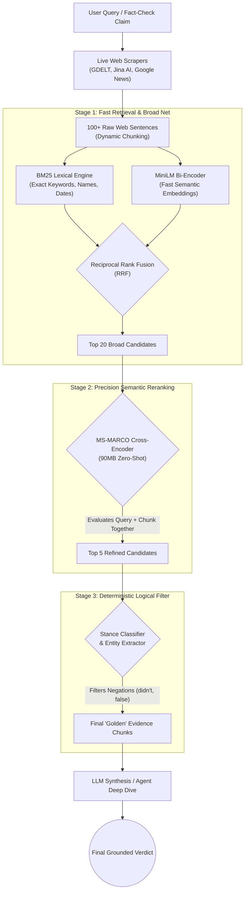

# CAWNCADE AI v3.0

**Context Aware Watch News Confirmation Authenticity Detection Engine**

A multi-tiered, fault-tolerant news verification platform with AI-powered reasoning.

## Architecture

For full details on pipelines, security models, LLM routing, and extraction logic, see the [Living Architecture Documentation (docs/ARCHITECTURE.md)](file:///C:/Users/ks919/Downloads/CAWNCADE%20AI/docs/ARCHITECTURE.md).

### The Two-Stage Hybrid RAG Pipeline (v3.5)
CAWNCADE uses an advanced, noise-resistant retrieval pipeline for live web data, utilizing **Reciprocal Rank Fusion (RRF)** and a **Zero-Shot Cross-Encoder**.



- **Backend**: FastAPI (Python 3.11) on port 7860
- **Frontend**: React 18 + Vite + Tailwind CSS
- **AI Agent**: Llama 3.3 70B Instruct (ReAct) via OpenRouter & HuggingFace Router
- **Search Engine**: 5-Tier fallback with circuit breaker pattern & FAISS semantic cache

## Features

- **ContextLens**: Verify text claims, news URLs, YouTube videos against 40+ trusted sources
- **Visual Lens**: Detect deepfakes, AI-generated, and morphed images
- **AI Reasoning**: Llama 3.1 ReAct agent performs autonomous multi-step investigation
- **Transparency UI**: See which search tier verified each claim
- **Google APIs**: Fact Check, Custom Search, Safe Browsing (single key)

## Search Tiers

| Tier | Service | Scope |
|------|---------|-------|
| Pre-Flight | Google Fact Check | Historical debunks |
| Pre-Flight | Google Safe Browsing | URL threat detection |
| Tier 1 | Google Custom Search | Trusted domains |
| Tier 2 | Tavily | AI-enhanced global search |
| Tier 3 | NewsData.io / NewsAPI | News aggregation |
| Tier 4 | DuckDuckGo | Free unlimited fallback |
| Tier 5 | Google News RSS / GDELT | Free RSS feeds |

## Hugging Face Spaces Secrets

| Variable | Required | Description |
|----------|----------|-------------|
| `HUGGINGFACE_API_TOKEN` | Yes | HF Inference API token |
| `GOOGLE_API_KEY` | Yes | Custom Search + Fact Check + Safe Browsing |
| `GOOGLE_SEARCH_CX` | Yes | Google Custom Search Engine ID |
| `TAVILY_API_KEY` | No | Tavily AI search |
| `NEWSDATA_API_KEY` | No | NewsData.io |
| `NEWS_API_KEY` | No | NewsAPI.org |
| `PROXY_URL` | No | Webshare rotating proxy |
| `JWT_SECRET_KEY` | No | JWT auth secret (auto-generated) |

## Persistent Storage

Mount a **Persistent Storage Bucket** to `/data` in your Space settings.
This stores the SQLite database and ChromaDB vector store.

## Local Development

```bash
# Backend
cd backend
pip install -r requirements.txt
uvicorn app.main:app --reload --port 7860

# Frontend (separate terminal)
cd frontend
npm install
npm run dev
```
